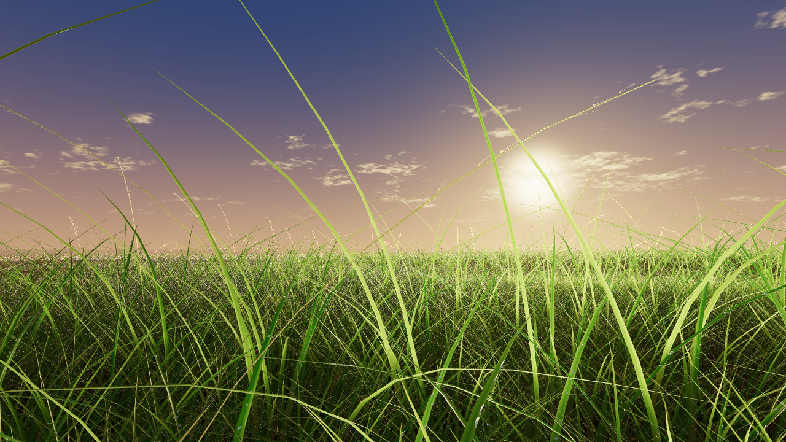

# Hyper-real meadow (Three.js / WebGL2)

Self-contained procedural grass terrain: no textures, no models, no build step. Three.js r187 is vendored in `vendor/`.



```bash
python3 -m http.server 8080      # any static server; ES modules need http://, not file://
# open http://localhost:8080/
```

Controls: drag = look, WASD/arrows = move (Shift ×4), Q/E or wheel = eye height, Space = auto-walk, H = hide UI.
URL params: `?q=low|med|high|ultra &el=9 (sun elevation °) &az=28 &wind=1 &dew=0.8 &exp=0.9 &cam=x,z,eye,yawDeg,pitchDeg &still=3.7 &ui=0`.
Quality auto-steps down once if the GPU can't hold ~24 fps (disabled when `q=` is given).

## Files

| file | role |
|---|---|
| `src/main.js` | renderer, atmosphere state, GPU bake, ring/instance setup, controls, UI |
| `src/glsl.js` | every shader chunk (common/noise/terrain/wind/sky/fog, leaf lighting, canopy, grass, clover, soil, sky, bake) |
| `src/geometry.js` | procedural blade, seed-stalk, clover-leaf and log-polar ground geometry |

## Architecture

**Instancing without instance buffers.** Each ring is an `InstancedBufferGeometry` with only `instanceCount` set.
The vertex shader derives `(cell, blade)` from `gl_InstanceID` in a camera-snapped, *world-aligned* grid and hashes (PCG) every
property, so placement is stable as the camera moves and costs no memory. Three blade rings (0–6 m, 6–22 m, 22–78 m; 8/4/2 segments)
cross-fade by stochastic thinning; stalks (2 rings) and clover (1 ring) are separate draws. Instances behind/outside the frustum
are collapsed in the VS before any heavy work.

**Botanical clustering.** A tileable multi-octave, domain-warped ecology map (tall stands / clover / thatch / lushness) is baked once on the GPU
(`BAKE_FS`) and sampled by blade VS, clover VS and soil FS. On top of it, a 0.5 m jittered *tussock* grid (shared VS/FS hash) makes
blades clump and lean outward from a root crown, and the soil darkens under each crown. Species per blade: mid blade, fine fescue, tall leafy culm,
dead golden thatch; plus seed stalks (3-sided culm, spiral spikelets, awns) and trifoliate clover.

**Blade topology & bending (analytic).** The vertex carries only a frame-local offset + shading normal (V-fold profile baked in).
The shader builds the centre-line `P(t) = (d(t), sqrt(t² − |d|²))` (chord-preserving, C¹ soft-saturated) with
`d = lean·t + droop·t²` (parabolic arch) `+ gust·S(t) + flutter(t)`, where `S(t) = t²(1.4−0.4t)` is the root-locked→supple stiffness curve and
the gust comes from advected rolling fronts. Because `d(t)` is analytic, its derivative gives the exact tangent; the orthonormal frame
(tangent, yaw/twist-rotated lateral axis, `N = T×A`, plus gust roll) rebuilds the vertex normal after bending, so highlights and sky reflections ripple with the wind.
Clover uses the Jacobian form `n' = n − ŷ(a·n)`.

**Light transport (`LEAF_LIGHTING`).** Wrap-diffuse; back-lit translucency with Beer–Lambert absorption per channel
(chlorophyll passes green/yellow) and a distorted-half-vector forward lobe; canopy self-shadowing `exp(−k·ρ·depth / sin(elevation))` plus
a multi-bounce fill; root-to-tip AO; GGX cuticle; a Kajiya–Kay streak and wet-film roughness on the rib; dew droplets as small lenses
(hemispherical normal, refracted background, sun glint); sky reflection through the recomputed normal. Albedo: damp humus root → etiolated sheath → chlorophyll → sun-bleached tip.

**Anti-aliasing.** The VS measures the pixel footprint at each blade's depth and widens sub-pixel blades while emitting coverage-preserving alpha
(`alphaToCoverage`, no sorting/blending). The FS flattens V-fold normals, widens roughness, fades veins/beads, and converges sub-pixel blades to the same
analytic canopy colour the soil uses at distance, so grass→ground has no seam. Soil octaves, pebbles and litter fade by their own wavelength vs. footprint.
Fog is analytic exponential-height with in-scatter taken from the sky function, so the horizon matches the sky exactly.

**Soil (`GROUND_FS`).** Log-polar mesh following the camera; analytic terrain height/normal shared (JS mirror) with the blades.
Layers: loam/humus/sand, footprint-filtered micro-relief fbm with analytic derivatives, crumb grain, pebbles, straw & leaf litter, thatch mat,
clover carpet, moisture (low ground + noise + dips) → darkening, roughness drop, moss, puddles; tussock-root AO and canopy shadow; GGX + sky reflection.

**Atmosphere.** `updateAtmosphere()` derives sun colour from path-length transmittance (Kasten–Young air mass, Rayleigh + aerosol) and sky/ambient/fog colours;
all shaders read the same uniform objects.

## Verification status

Rendered and inspected in headless Chromium on a software WebGL2 rasteriser (SwiftShader): all programs compile cleanly, frames are correct and animate,
UI/keyboard/pointer paths run without console errors. **Frame rate on real GPUs has not been measured**; `high` submits ~28 M indices/frame
(many collapse in the VS), so expect `med` for integrated GPUs. `docs/preview.png` was rendered at `?q=high`.
